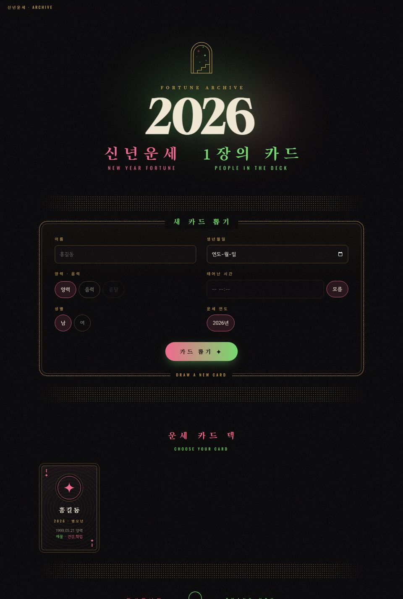
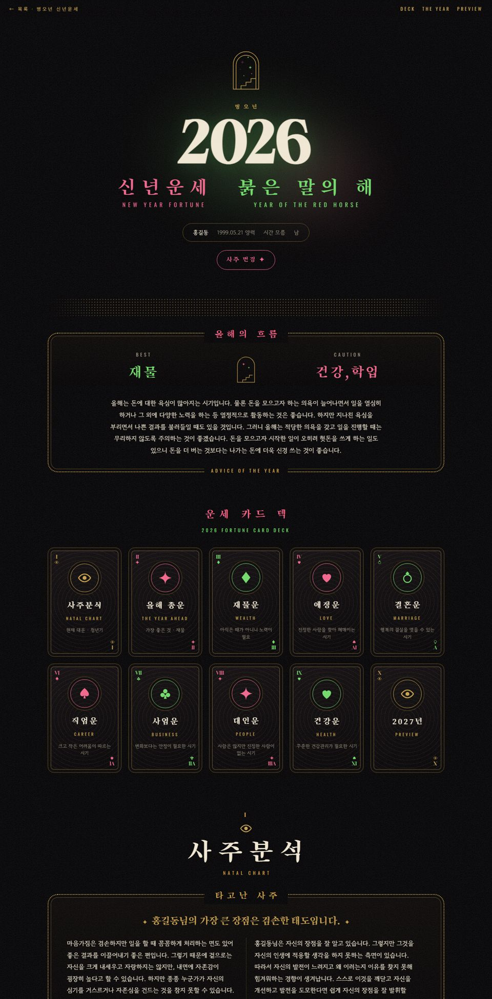
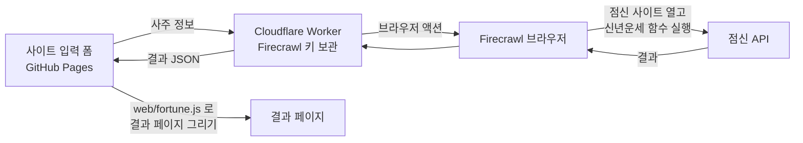

# 신년운세 카드 덱

점신(jeomsin.co.kr)의 **2026 병오년 신년운세**를 Firecrawl로 수집해서, 타로 카드 덱 스타일의 웹페이지로 보여주는 프로젝트입니다.
사이트에서 이름·생년월일·태어난 시간·성별을 입력하면 30초 안에 그 사람의 운세 결과 페이지가 만들어집니다.

- **사이트**: https://juwookim.github.io/jeomsin-newyear/
- **운세 API (Cloudflare Worker)**: `https://jeomsin-fortune.juwookim.workers.dev/fortune`

| 첫 화면 (입력 폼 + 카드 목록) | 결과 페이지 |
| --- | --- |
|  |  |

---

## 무엇을 할 수 있나

- **사주 정보 입력**: 이름, 생년월일, 양력/음력(윤달), 태어난 시간(모름 가능), 성별을 넣고 **카드 뽑기**를 누르면 결과가 나옵니다.
- **사주 변경**: 결과 페이지의 **사주 변경 ✦** 버튼으로 정보를 고쳐 다시 뽑을 수 있습니다.
- **운세 10개 항목**: 사주분석(타고난 사주·대운), 올해 총운, 재물운, 애정운, 결혼운, 직업운, 사업운, 대인운, 건강운, 미리보는 2027년(항목별 점수 포함).
- **카드 목록**: 저장해 둔 사람들의 결과를 카드로 모아 보여줍니다.

---

## 동작 방식



### 왜 이렇게 크롤링하나

`https://www.jeomsin.co.kr/newyearunse`는 프로필(이름·생년월일 등)이 있어야 결과가 보이는 React 페이지입니다.
프로필 없이 그냥 크롤링하면 메인 페이지로 넘어가 버리고, 결과 요청은 사이트 안에서 AES로 암호화되어 나갑니다.

그래서 Firecrawl 브라우저로 점신을 연 뒤 `executeJavascript` 액션으로 **사이트가 자기 결과를 불러올 때 쓰는 함수**를 직접 실행합니다.
암호화와 요청은 사이트 코드가 그대로 처리하고, 결과만 받아옵니다.

- 신년운세 요청 함수는 webpack 모듈 `53974`, 항목 종류는 모듈 `75910`의 `Kt`(총운 3, 재물 4 … 건강 10, 미리보는 해 12)입니다.
- Firecrawl의 JS 반환값은 한글이 깨지기 때문에, 페이지 안에서 `\uXXXX`로 이스케이프한 뒤 받아서 복원합니다.
- 점신은 "태어난 시간 모름"을 **00시 00분**으로 보내므로 똑같이 보냅니다.

---

## 파일 구조

| 파일 | 역할 |
| --- | --- |
| `jeomsin_newyear.py` | Firecrawl 크롤러. 인자를 빼면 정보를 하나씩 물어보고, 결과 JSON·MD 저장, 결과 페이지와 목록 생성까지 한 번에 합니다. |
| `build_site.py` | 결과 JSON을 카드 덱 디자인의 HTML로 만듭니다. 목록 페이지(`index.html`)와 브라우저용 파일(`fortune.js`, `fortune-data.js`)도 만듭니다. |
| `app.py` | 내 PC에서 실행하는 웹앱(`http://127.0.0.1:8000`). 입력 폼으로 뽑은 결과가 `output/`에 저장됩니다. |
| `worker/worker.js` | Cloudflare Worker. 사이트 폼의 요청을 받아 Firecrawl로 운세를 가져와 JSON으로 돌려줍니다. |
| `web/fortune.js` | 사이트의 브라우저 스크립트. 폼을 Worker로 보내고, 받은 결과를 결과 페이지로 그립니다. `build_site.py`와 똑같은 HTML을 만들도록 옮겨 왔습니다. |
| `deploy_worker.py` | Cloudflare API로 Worker를 배포하고, Worker 주소를 `site_config.json`에 저장한 뒤 페이지를 다시 만듭니다. Node.js가 없어도 됩니다. |
| `site_config.json` | 사이트 입력 폼이 호출할 Worker 주소. 비어 있으면 입력 폼 없이 페이지만 만듭니다. |
| `output/` | GitHub Pages로 배포되는 폴더. 결과 페이지(`.html`), 원본 데이터(`.json`), 읽기용 텍스트(`.md`)가 들어 있습니다. |
| `.github/workflows/pages.yml` | `main`에 푸시하면 `output/`을 GitHub Pages로 배포합니다. |

---

## 사용법

### 1. 준비

Python 3만 있으면 됩니다(외부 패키지 없음). 프로젝트 폴더에 `.env` 파일을 만들고 키를 넣습니다. **`.env`는 저장소에 올라가지 않습니다.**

```
FIRECRAWL_API_KEY=fc-...
CLOUDFLARE_API_TOKEN=...      # Worker 배포할 때만 필요
```

### 2. 운세 뽑기 (내 PC)

```bash
python app.py                  # 브라우저 입력 폼이 열립니다
python jeomsin_newyear.py      # 터미널에서 하나씩 입력
python jeomsin_newyear.py --name 홍길동 --birth 1999-05-21 --gender male            # 시간 모름
python jeomsin_newyear.py --name 홍길동 --birth 1999-05-21 --time 14:30 --calendar lunar --leap --gender female
```

결과는 `output/newyear_<연도>_<이름>_<생년월일>.{json,md,html}`로 저장되고, `output/index.html` 카드 목록에 추가됩니다.
디자인만 다시 만들고 싶으면 `python build_site.py`를 실행합니다.

### 3. 사이트에 반영

```bash
git add output
git commit -m "새 운세 추가"
git push
```

푸시하면 1분 안에 GitHub Pages에 자동으로 반영됩니다.

### 4. 사이트 입력 폼용 Worker 배포

1. Cloudflare 무료 계정을 만들고 이메일 인증을 마칩니다.
2. My Profile → API Tokens → **Create Token** → **Edit Cloudflare Workers** 템플릿으로 토큰을 만들고, `.env`에 `CLOUDFLARE_API_TOKEN=`으로 넣습니다.
3. `python deploy_worker.py`를 실행합니다. 처음이라 `workers.dev` 하위 도메인이 없으면 `python deploy_worker.py --subdomain 원하는이름`으로 실행합니다.
4. 커밋하고 푸시합니다.

Worker 코드를 고쳤을 때도 `python deploy_worker.py`를 다시 실행하면 됩니다.

---

## 디자인

Behance의 [Eltoro Studio 15th Anniversary](https://www.behance.net/gallery/176931635/Eltoro-Studio-15th-Anniversary) 작업을 참고했습니다.

- **색과 질감**: 필름 그레인이 있는 검정 배경에 핫핑크와 애시드 그린을 대비시키고, 금색 점선 프레임과 금색 도트 띠를 둘렀습니다.
- **타로·카드 모티프**: 별과 계단이 있는 아치 문 엠블럼, 원으로 만든 카드 무늬(♠ ♥ ♣ ◆ ✦), 10장의 운세 카드 덱을 넣었습니다.
- **글꼴**: Gloock(숫자), Song Myung(한글 제목), Gowun Dodum(본문), Oswald(영문 라벨)를 썼습니다.
- **한글 표기**: 한자 없이 한글만 씁니다(병오년, 붉은 말의 해). 연도를 바꾸면 간지와 띠가 자동으로 계산됩니다.
- **화면 크기**: 모바일(390px)부터 데스크톱까지 깨지지 않게 맞췄습니다.

---

## 오늘 작업 기록 (2026-10-12)

1. **크롤링 방법 찾기**
   - `/newyearunse`를 그냥 크롤링하면 메인 페이지로 넘어가는 것을 확인했습니다.
   - 사이트 JS 번들을 분석해 신년운세 요청 함수와 항목 코드를 찾았습니다.
   - Firecrawl 브라우저 액션으로 그 함수를 실행해 10개 항목을 모두 받아왔습니다.
2. **한글 깨짐 해결**: Firecrawl 반환값에서 한글이 깨져서, 페이지 안에서 `\uXXXX`로 이스케이프한 뒤 받아 복원했습니다.
3. **"시간 모름" 처리 확인**: 점신의 입력 폼 코드에서 "시간 모름"이 00시 00분으로 전송되는 것을 확인하고 똑같이 맞췄습니다.
4. **결과 페이지 디자인**: Behance 레퍼런스를 Firecrawl로 캡처해 분석하고, 카드 덱 스타일 결과 페이지를 만들었습니다.
5. **여러 사람 지원**
   - 명령 하나로 크롤링부터 페이지 생성까지 되게 했습니다.
   - 카드 목록 페이지와 로컬 웹앱(`app.py`)을 추가했습니다.
6. **한자 → 한글**: 디자인에 있던 한자를 모두 한글로 바꿨습니다.
7. **사주 변경 기능**: 결과 페이지에서 정보를 고쳐 다시 뽑을 수 있게 했습니다.
8. **2027년 확인**: 2027년으로 요청하면 점신이 빈 결과를 돌려줘서, 연도는 2026년만 두었습니다. 지원하지 않는 연도는 안내 문구를 보여줍니다.
9. **claude.ai 링크**: 결과 페이지를 claude.ai 링크로도 만들었습니다.
10. **GitHub Pages 배포**: 공개 저장소를 만들고, Actions로 `output/`을 배포했습니다.
11. **사이트 입력 폼**
    - Cloudflare Worker를 배포하고, 사이트에서 바로 사주를 입력해 결과를 볼 수 있게 했습니다.
    - Worker 결과가 로컬 결과와 똑같은지 확인했습니다.
    - 브라우저 렌더러가 Python 렌더러와 글자 하나까지 같은 HTML을 만드는지 비교했습니다.

---

## 보안과 제한

- **키 보관**
  - Firecrawl 키는 `.env`와 Cloudflare Worker 비밀값에만 있습니다. 사이트 코드와 저장소에는 없습니다.
  - Worker는 `https://juwookim.github.io`에서 온 요청만 받고(`ALLOWED_ORIGINS`), IP당 1분에 2회로 호출을 제한합니다.
- **입력 검증**: 이름 1~20자, 날짜·시간 형식, 연도를 검사하고, 잘못된 값이면 이유를 알려줍니다.
- **크레딧**: 사이트에서 한 번 뽑을 때마다 Firecrawl 크레딧이 1회 쓰입니다.
- **결과 저장**: 사이트에서 뽑은 결과는 어디에도 저장되지 않습니다. 새로고침하면 사라집니다. 목록에 남기려면 내 PC에서 뽑은 뒤 푸시합니다.
- **사이트 변경 위험**: 점신이 사이트를 다시 배포하면 webpack 모듈 번호(`75910`, `53974`, 청크 `7725/4380/4806`)가 바뀌어 크롤링이 멈출 수 있습니다. 그때는 `jeomsin_newyear.py`와 `worker/worker.js`의 번호를 새로 찾아 바꿔야 합니다.
- **연도**: 점신은 현재 2026년 운세만 제공합니다.

---

운세 데이터 출처: 점신(jeomsin.co.kr) · Firecrawl로 수집 · 개인 열람용
